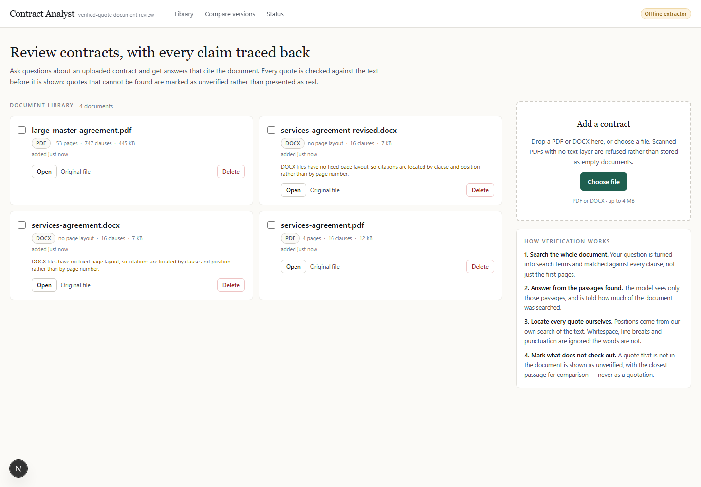
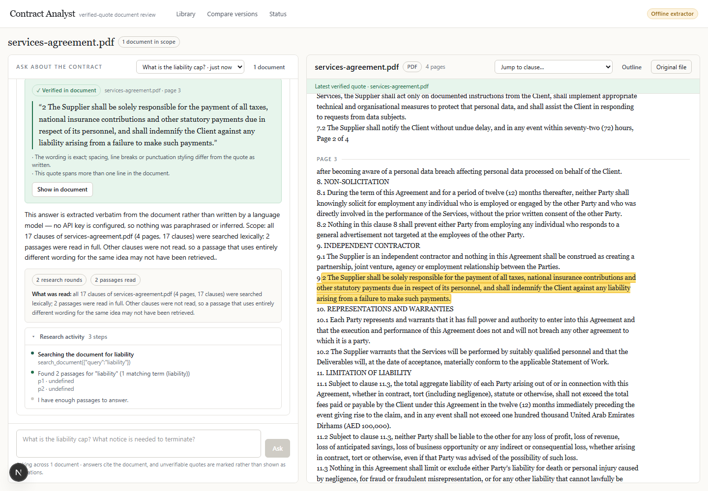
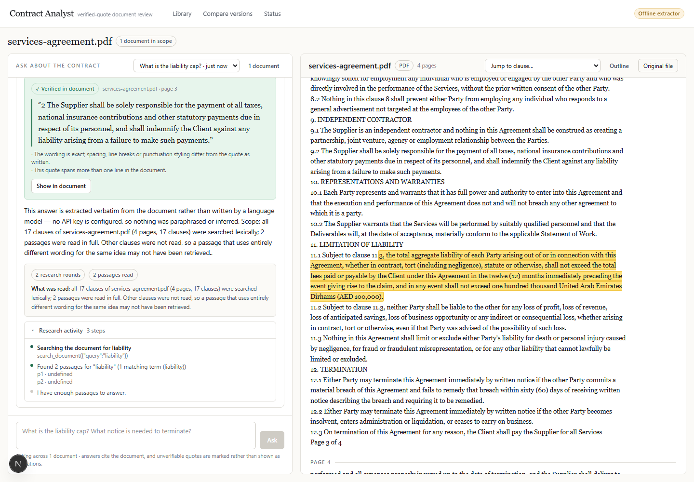
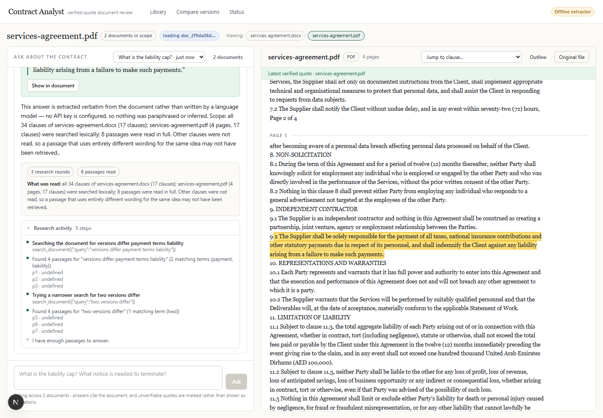
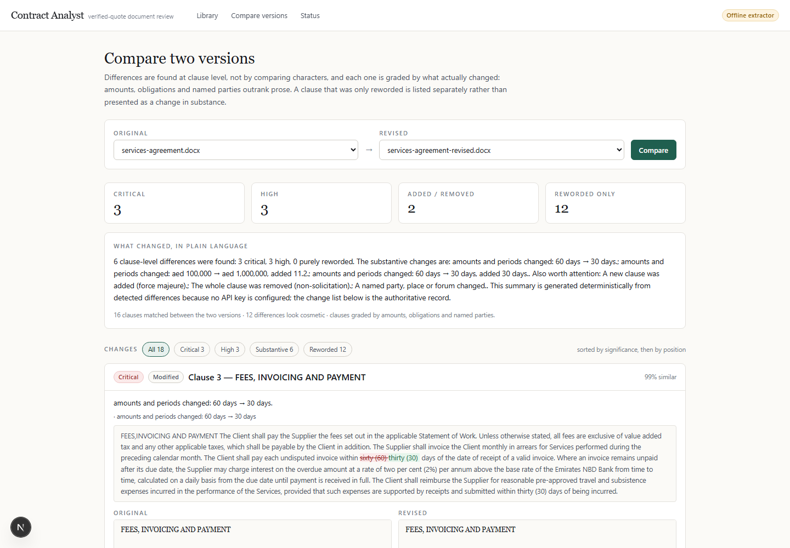
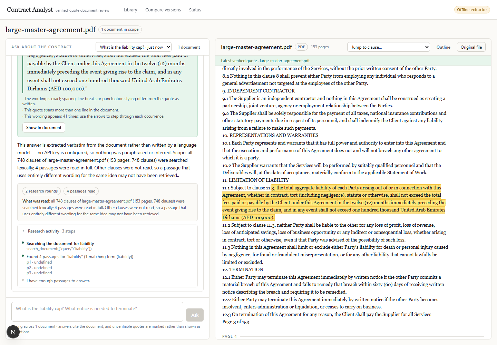

# Contract Analyst

Upload a legal contract as a PDF or DOCX, ask questions about it in a chat, and get
answers that quote the document. Every quote is checked against the extracted text
by this application before it is shown to you: if the words are not in the contract,
the quote is marked as unverified rather than presented as though it were real.

**Live app:** _add your Vercel URL here after deploying — see [Deploying](#deploying)_
**Demo video:** _add the Loom / Drive / unlisted YouTube link here_
**Approach and limitations (half a page):** [NOTES.md](./NOTES.md)

---

## Screenshots

### 1. Upload and the document library



A dropped file is accepted or refused with a written reason. A scanned PDF with no
text layer is refused here rather than stored as an empty document; a document with
* some* unreadable pages is accepted and the unreadable page numbers are listed in
the library next to it.

### 2. A question, answered with a verified quote



The answer streams in, the research steps are shown as they happen rather than as a
spinner, and each quote is rendered as a card with its verdict, its page, and the
passage it was found at. The banner underneath states exactly how much of the
document was searched.

### 3. Clicking a quote opens and highlights the passage



"Show in document" maps the verified offsets back onto the rendered page text,
scrolls to the passage and highlights it. The mapping is offset based, so a quote
that wraps across several lines, crosses a page break, or appears more than once is
handled by the same code path (occurrences are counted and can be stepped through).

### 4. One question across two documents



Documents are ticked in the scope selector and one question is asked across all of
them. Each quote is verified against **its own** document, and the card names the
document it came from.

### 5. Clause-level comparison of two versions



Two versions are compared clause by clause, not character by character. Each change
is graded, the summary is plain language, and a clause that was only reworded is
listed separately from a clause whose liability cap moved from AED 100,000 to
AED 1,000,000.

### 6. A 150-page contract



The 153-page fixture answers normally, and the coverage banner says which parts of
the document were searched and whether the research budget ran out.

These are generated, not hand-captured: `npm run shots` drives the running app in
headless Chrome and writes all six files.

---

## What the app does

### Part A — core features

| Requirement | How it works |
| --- | --- |
| Accept PDF and DOCX | `src/lib/extract/index.ts`. PDF via `unpdf` (page-aware), DOCX via `mammoth`. |
| Reject other types with a clear message | The extension **and** the file's own leading bytes are checked. `.doc`, `.txt`, `.rtf`, images and emails each get a message that says what to do instead. |
| Show processing status | Every request has a visible state: uploading, extracting, "Searching the document before answering…", live research steps, and a Stop button that appears only while a stream is open. |
| Handle a scanned PDF honestly | A PDF with no text layer is refused with `no-text` and is **not** saved. A partially scanned PDF is saved with a warning naming the pages without text, because quotes cannot be verified against them. |
| Document library | `src/app/page.tsx` + `src/components/LibraryView.tsx`: list, page/character/clause counts, warnings, open, delete (which also drops the chat history that referenced it). Re-uploading identical bytes returns the existing document instead of silently forking its history. |
| Streamed answers | Newline-delimited JSON over a streamed response; the client reads the body incrementally. |
| Stop keeps what was written | The request is aborted through an `AbortController`; the partial text is kept, stored with status `stopped`, and labelled in the UI as "stopped — partial answer kept". |
| Per-document saved history | Conversations are stored per document set and can be reopened from the dropdown, including the quotes, steps and coverage that produced each answer. |
| **Verified quotes** | See [below](#how-quote-verification-works). Positions come from this application's own search of the text. |
| Unverifiable quotes are marked | Verified, partly verified and not-in-document are three distinct cards. A rejected quote is shown struck through, with the closest passage disclosed separately as *reference only* and never as a quotation. |
| Abstain when it is not covered | Retrieval reports `noMatch` and the answer says the document does not appear to cover the question, rather than reaching for the least-bad passage. |
| 150 pages | See [large documents](#how-large-documents-are-handled). |

### Part B — advanced features

- **Citation highlighting.** The viewer re-derives the highlight from verified
  offsets, splits each page's text around them and marks the exact characters.
  Multi-line, cross-page and repeated quotes all work; repeated wordings are counted
  and can be stepped through, and the occurrence the answer was actually built from
  is preferred rather than the first accidental repeat.
- **Multi-document questions.** The scope selector adds documents to the question
  (`?also=` in the URL, so a scope can be linked). Retrieval runs across the whole
  scope, each quote carries the id of the document it must be verified against, and
  the answer is written across the documents rather than as one answer per document.
- **Document comparison.** `src/lib/compare/compare.ts` aligns clauses between two
  versions, classifies each difference as added / removed / modified / reworded, and
  scores significance from what actually changed — quantities and periods, negation,
  obligation wording (shall/may/must), and named entities. Cosmetic differences are
  counted and kept out of the way. The change list can be filtered and is sorted by
  significance.

### Part C — Option 2: agentic document research

I chose Option 2 because it attacks the problem this app actually has. A 153-page
contract does not fit in a prompt, so something has to decide what to read — and
making that the model's job, with real tools and real results, is both the honest
architecture and the more interesting one. Reasoning is in
[NOTES.md](./NOTES.md).

- **Real tools, not prompt stuffing.** `search_document`, `get_section`,
  `list_clauses` and `get_document_overview` are dispatched in
  `src/lib/agent/tools.ts`; the model never sees the document text unless it asks
  for it.
- **A real multi-round loop.** `src/lib/agent/runner.ts` lets the model call tools,
  read the results and call more, up to `AGENT_MAX_ROUNDS` (default 6).
- **Visible progress.** Each round emits `step` events — "Searching for termination
  provisions…", which tool, which arguments, what came back — rendered as a live
  timeline that stays on the finished answer.
- **Hard caps.** A round cap and a total tool-call budget (8) end the loop with an
  honest "research cut short" badge.
- **Malformed calls survive.** An unknown tool name, missing arguments, wrong
  argument types or nonsense parameters produce a correction message back to the
  model. One repair attempt is made; after two consecutive unusable calls the loop
  stops and answers with what it has. None of this can fail the request.
- **Verified quotes still apply.** The final answer goes through exactly the same
  extraction and verification path as any other answer.

---

## How quote verification works

`src/lib/text/verify.ts` is the most important file here.

The model is asked to cite with `<quote doc="p3">exact words</quote>`. The server
streams the raw text, parses out each completed quote, verifies it, and emits a
`quote` event with a verdict *before* the `done` event. The client never sees a
quote that has not been through verification.

**Nothing the model says about a location is trusted.** `doc="p3"` is used only to
say which document a quote is about. The page number, offset and span that the user
sees all come from this application's own search of the extracted text.

Matching is layered, from strict to tolerant, and each layer is reported to the user
so a tolerant match is never passed off as an exact one:

1. **exact** — the words match after folding whitespace runs, line breaks,
   typographic quotes/dashes, ligatures, ellipses and invisible characters
   (soft hyphens, zero-width spaces).
2. **case-insensitive** — the same words, different capitalisation.
3. **punctuation-trimmed** — punctuation at the *edges* of the quote was added or
   dropped.
4. **hyphen-joined** — the document hyphenated a word across a line break
   ("indemnifi-\ncation").

No layer can reorder, substitute or drop a word, so a paraphrase fails all of them.
A quote split by an ellipsis or a bracketed insertion is treated as **segments**:
every segment must be located, in order, and the parts that were not found are named
instead of being presented as quotation. What could not be found is reported as
`partial` or `unverified`, along with the closest passage and its word-overlap score,
so you can see what the model was probably reaching for without ever being shown it
as a quote.

Offsets are mapped back to the original characters through a normalised-text index
map, which is what makes the highlighting land on the right characters even though
the search ran over a whitespace-collapsed copy.

**Where it can fail** is set out in [NOTES.md](./NOTES.md).

---

## How large documents are handled

A 153-page fixture (505,000 characters, 747 clauses) is in `fixtures/` and is used
by the test suite.

- The text is chunked on clause boundaries (`src/lib/text/chunk.ts`), so a chunk
  never straddles two top-level clauses and each chunk knows its clause number,
  heading and page.
- Retrieval searches **every** chunk — BM25 with a phrase bonus, plus a stopword list
  tuned for contract questions — and returns the best passages. It is not a linear
  scan of the first N pages, and there is a test that reaches a clause in the last 3%
  of the 150-page contract.
- If the model is reasoning over the text itself (Option 2), the agent decides what
  to read through its tools, so only the passages it asks for are ever sent.
- **The app never answers as though it read more than it did.** Every answer carries
  a coverage report — chunks searched, documents searched, passages used — and a
  sentence saying so, rendered in a banner under the answer. If the round or
  tool-call budget runs out first, the answer is marked "research cut short" instead
  of being presented as complete.

---

## Running it locally

Requires Node 20 or newer.

```bash
npm install
cp .env.example .env.local     # Windows: copy .env.example .env.local
npm run dev                    # http://localhost:3000
```

With no API key set the app runs against its **offline deterministic extractor**: it
plans research rounds, extracts sentences verbatim from the retrieved passages and
answers with real `<quote>` markers, so the streaming, verification and highlighting
paths all work end to end with nothing installed and nothing to pay for. The UI
labels those answers "offline extractor" rather than "AI".

To use a language model, set these in `.env.local`:

```ini
LLM_API_KEY=sk-or-...
LLM_BASE_URL=https://openrouter.ai/api/v1
LLM_MODEL=openai/gpt-4o-mini
```

Any OpenAI-compatible endpoint works (OpenRouter, OpenAI, Together, Groq, a local
llama.cpp or Ollama server). Keys are read from the environment only and are never
committed. **No key is present in this repository.**

Sample contracts are committed in `fixtures/`, so there is something to upload
immediately. They are generated — regenerate them with `npm run fixtures`.

### Commands

| Command | What it does |
| --- | --- |
| `npm run dev` | Development server on port 3000. |
| `npm run build` / `npm start` | Production build and server. |
| `npm run verify` | Typecheck, lint and the full test suite. |
| `npm test` | Vitest (88 tests). |
| `npm run fixtures` | Regenerate the sample contracts. |
| `npm run shots` | Capture the six screenshots above from a running app. |

### Environment variables

| Variable | Default | Notes |
| --- | --- | --- |
| `LLM_API_KEY` | — | Empty or a placeholder like `<your_key>` is treated as absent. |
| `LLM_BASE_URL` | `https://openrouter.ai/api/v1` | Any OpenAI-compatible base URL. |
| `LLM_MODEL` | `openai/gpt-4o-mini` | Model name. |
| `LLM_APP_URL`, `LLM_APP_TITLE` | — | Sent as `HTTP-Referer` / `X-Title` for OpenRouter. Optional. |
| `LLM_MAX_TOKENS`, `LLM_TIMEOUT_MS` | `1200`, `60000` | Answer length and request timeout. |
| `AGENT_MAX_ROUNDS` | `6` | Clamped to 2–10. |
| `DATABASE_URL` | empty | Empty means local SQLite at `.data/app.db`. Set it to a Postgres URL in production. |
| `SQLITE_PATH` | `.data/app.db` | Where the local database lives. |
| `ALLOWED_ORIGINS` | empty | Comma-separated CORS origins; empty means same-origin only. |

### The database

One set of SQL, two drivers (`src/lib/db/`). With `DATABASE_URL` empty the app uses
SQLite through `better-sqlite3` — nothing to install, nothing to run. With
`DATABASE_URL` set it uses Postgres through `pg`, and the same statements are
rewritten from `?` placeholders to `$n`. The schema is embedded as a string in
`src/lib/db/schema.ts` so the bundler always ships it, and a test asserts it avoids
SQL that works on one engine but not the other.

If neither works — for example a serverless deployment where `DATABASE_URL` was
forgotten — the SQLite file falls back to the temporary directory and `/api/health`
says so, rather than every upload failing with a filesystem error.

---

## Deploying

The app is built for Vercel plus a hosted Postgres (Neon's free tier is enough).

1. Push this directory to a GitHub repository.
2. Create a Postgres database and copy its connection string. The pooled
   `?sslmode=require` URL Neon shows under **Connection Details** is what you want.
3. In Vercel, import the repository and set:
   - `DATABASE_URL` = the Neon connection string
   - `LLM_API_KEY`, `LLM_BASE_URL`, `LLM_MODEL` for the provider you are using
   - `AGENT_MAX_ROUNDS` (optional)
4. Deploy. The schema is created on the first request; `GET /api/health` reports
   which store and which provider the running deployment is actually using, so the
   deployment can be checked from a browser without guessing.

`npm run build` completes cleanly (12 routes) and is what Vercel runs.

---

## Tests

88 tests across 5 files, run with `npm run verify`:

| File | Covers |
| --- | --- |
| `tests/verify.test.ts` (28) | Normalisation and the whole verification ladder: exact, case, punctuation, hyphen-joined, invisible characters, ellipsis and bracketed insertions, cross-page quotes, duplicated wording and occurrence preference, paraphrases and fabrications, weak evidence. |
| `tests/documents.test.ts` (18) | PDF/DOCX extraction, page maps, every rejection path (scanned, damaged, misnamed, legacy `.doc`, empty, oversized), chunk boundaries respecting clauses, clause outline, retrieval including the far end of the 153-page contract, and "no match" instead of a least-bad match. |
| `tests/agent.test.ts` (14) | The agent loop end to end on the offline provider, tool dispatch, the round cap, malformed and invented tool calls, and abstention. |
| `tests/compare.test.ts` (14) | Clause alignment, added/removed/reworded classification, significance scoring, and that a reworded clause is not reported as a substantive change. |
| `tests/storage.test.ts` (14) | Schema portability, placeholder rewriting, insert/list/delete, duplicate detection by content hash, per-document history, keeping a stopped partial answer, comparison persistence. |

---

## What is finished and what is not

**Finished and exercised.** Everything in Parts A and B, and Option 2 of Part C, is
implemented and covered by the tests above. The six screenshots were captured from
the real running app; the production build completes; `npm run verify` (typecheck,
lint, 88 tests) passes.

**Known limitations, stated plainly.**

1. **The language-model path has not been run from this checkout.** No API key was
   available, so every screenshot and every test uses the offline deterministic
   extractor. The OpenRouter/OpenAI-compatible provider is implemented and shares the
   same request and streaming code as the offline one, but it has not been exercised
   against a live endpoint here. Set `LLM_API_KEY` and it takes over.
2. **The Postgres path has not been run against a live server from here.** The
   dialect rewrite and the repository queries are unit tested and the schema is
   written to avoid engine-specific SQL, but only SQLite has served real requests.
   `/api/health` reports which engine answered.
3. **DOCX has no page numbers.** Word documents carry no fixed page layout, so
   citations in a DOCX are located by clause and offset and the page label is omitted
   rather than guessed.
4. **No OCR.** A scanned PDF is refused with an explanation instead of being run
   through OCR. That is a deliberate choice: an OCR'd quote is not the document's
   words, and this app's whole claim rests on quotes being exact.
5. **Retrieval is lexical, not semantic.** BM25 plus a phrase bonus, not embeddings.
   It handles contract phrasing well but a question using entirely different
   vocabulary from the clause can miss.
6. **Chat history can be reopened but not deleted** from the UI. Deleting a document
   does remove the conversations that referenced it.
7. **Clause extraction is an outline, not a classifier.** The clause number, heading,
   page and jump-to target are extracted and used throughout; clauses are not typed
   as "termination" / "liability" / etc.

**Not attempted.** The optional extras: anonymisation, embeddings, export to
PDF/Word, Arabic and RTL, background processing that survives a restart, and voice
input. Parts A, B and C were the priority, and an unfinished extra helps nobody.

---

## Repository layout

```
src/
  app/                     routes: /, /documents/[id], /compare, /api/*
  components/              UI — workspace, chat, document viewer, quote cards, comparison
  lib/
    agent/                 the Option 2 loop: tools, prompts, runner, stream events
    compare/               clause alignment, diffing, significance scoring
    db/                    one SQL dialect, SQLite and Postgres adapters, embedded schema
    extract/               PDF and DOCX text extraction, with typed failures
    llm/                   provider selection, OpenAI-compatible client, offline extractor
    search/                tokenising and BM25 ranking
    storage/               repository and per-process document bundles
    text/                  normalisation, page-aware document model, chunking, VERIFICATION
  tests/                   88 tests
tools/                     fixture generator and the screenshot driver
fixtures/                  sample contracts (PDF and DOCX, including 153 pages and a scan)
docs/screenshots/          the images above
```
